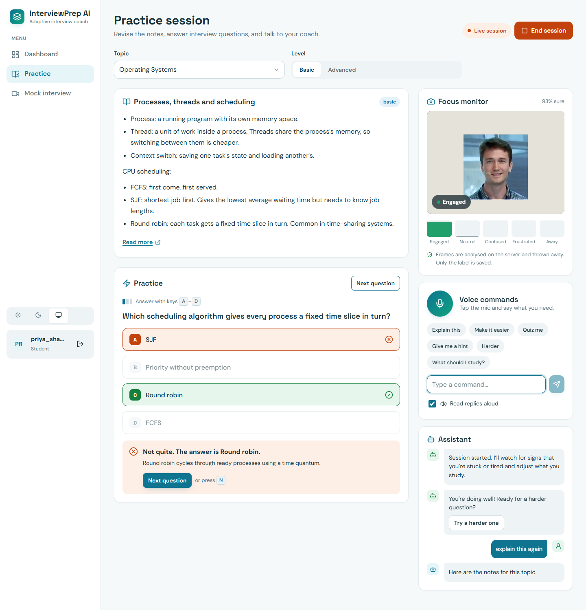
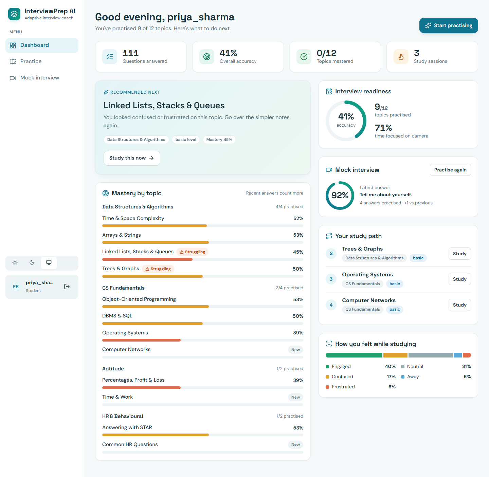
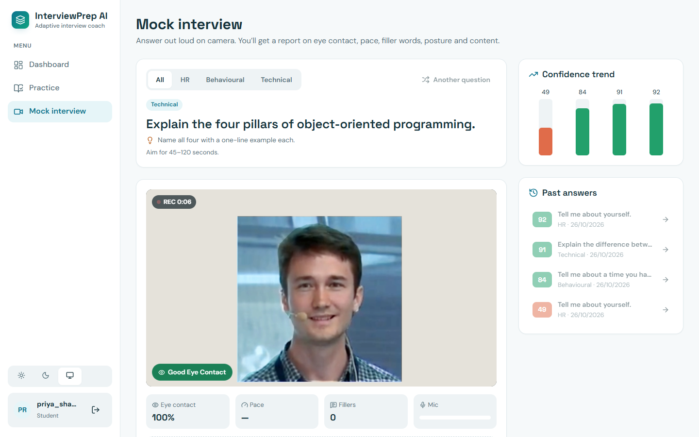
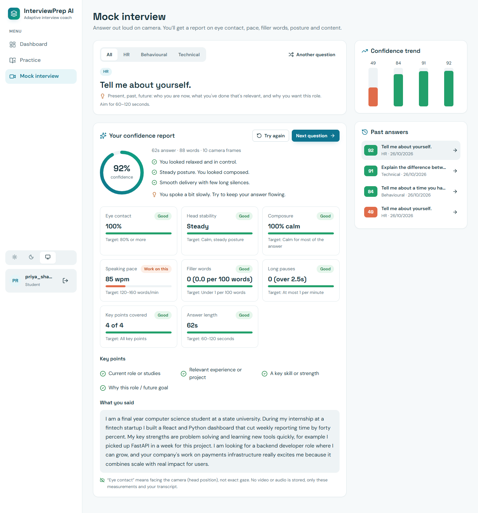
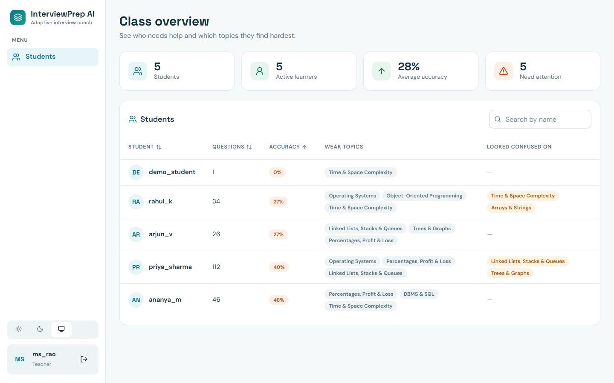
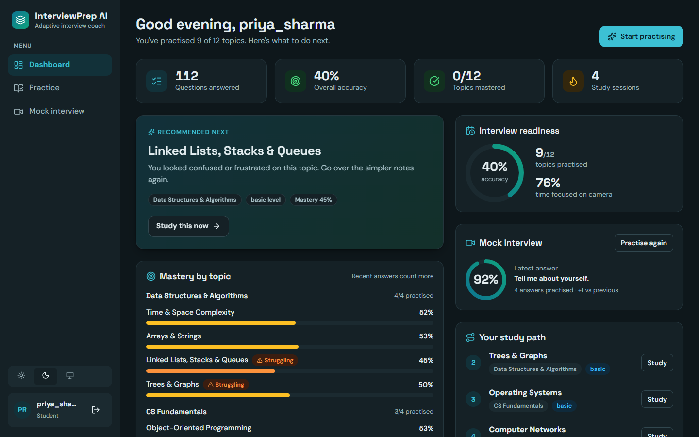
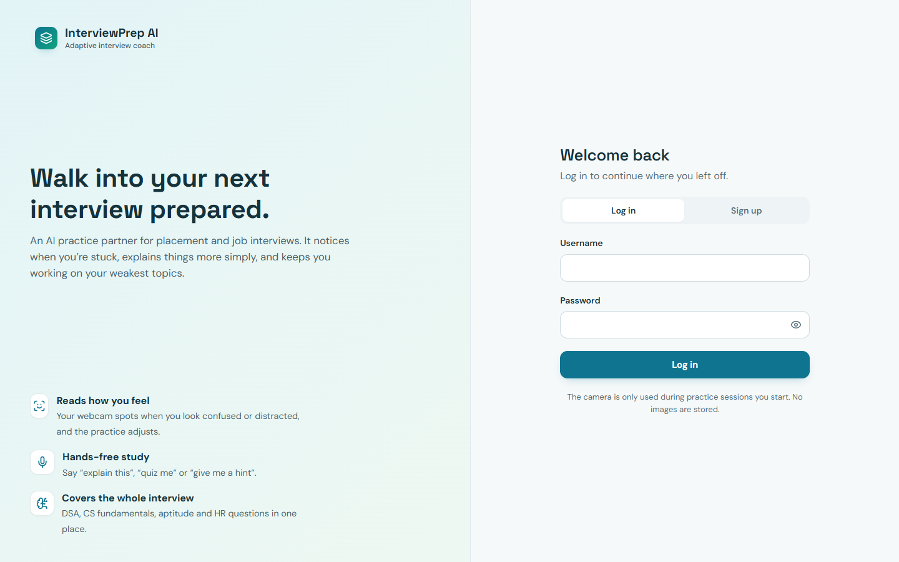
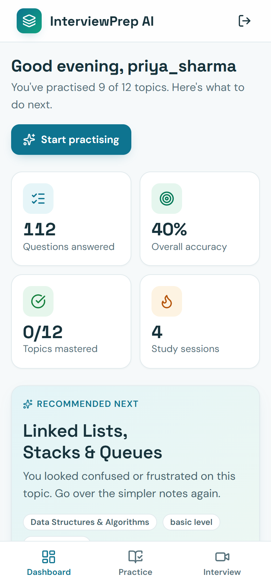
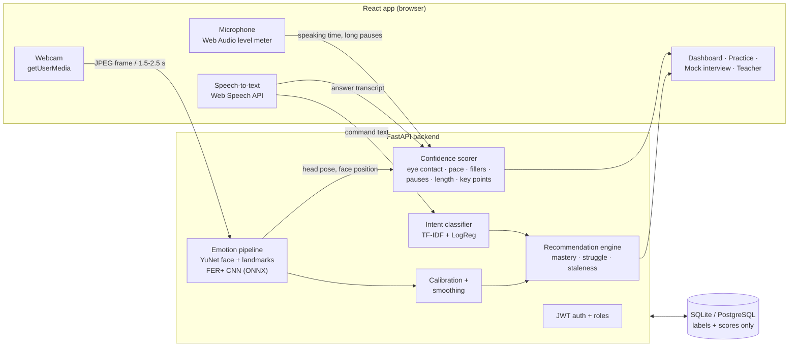

<div align="center">

# InterviewPrep AI

**An AI interview coach that watches, listens and adapts.**
It reads your facial expressions through the webcam, takes voice commands, runs mock interviews, and scores your confidence and body language. All of this feeds a recommendation engine that decides what you should practise next.




</div>

---

## Why this project

Students preparing for placements usually study alone, from material that treats everyone the same. **InterviewPrep AI** adapts to the student in real time:

- It **notices when you're stuck.** A CNN reads your expression every few seconds. When you look confused or frustrated, it offers simpler notes and an easier question. When you look away, it suggests a break.
- It **listens.** Say "explain this", "give me a hint" or "quiz me", and an NLP intent classifier works out what you mean.
- It **interviews you.** Answer a real interview question out loud and get a scored report on eye contact, posture, pace, filler words, pauses, answer length and the key points you covered.
- It **plans your practice.** A recommendation engine combines quiz mastery, emotional struggle and how long since you last practised each topic to rank what to study next.
- It **keeps teachers informed.** A class overview shows each student's weak topics and where they looked confused.

## Highlights for reviewers

| | |
|---|---|
| **Computer vision** | YuNet face detection with landmarks → square face crop → FER+ emotion CNN (ONNX Runtime). Head yaw and pitch are computed from the landmarks for "looking away" and eye-contact detection. |
| **Measured, not guessed** | Evaluated on **1,800 labelled FER2013 test faces**. Replacing the naive "top emotion" rule with grouped probabilities and tuned thresholds raised confused-face detection from **25% to 53%** and frustrated from **37% to 53%** (tuned on one half of the data, measured on the other). |
| **Personalisation** | Per-session calibration learns each student's resting face, so a naturally serious face isn't flagged as confused. Labels are smoothed over several frames and feedback is rate-limited. |
| **NLP** | TF-IDF (word and character n-grams) with logistic regression for 10 voice-command intents. Character n-grams make it tolerant of speech-to-text errors. Low-confidence commands are rejected as "unknown". **74%** accuracy in 5-fold cross-validation on phrasings it hasn't seen. |
| **Explainable scoring** | The confidence report is rule-based: every number traces back to a measurement (frames, words per minute, mic-level pauses, keyword coverage) and comes with a target and a tip. |
| **Engineering** | FastAPI + SQLAlchemy, JWT auth with roles, teacher sign-up protected by a code, input validation, and per-user data isolation (tested). **44 automated tests**, plus GitHub Actions CI for the backend and the frontend lint/build. |
| **Product polish** | React 19 single-page app with a token-based design system, light/dark themes, a responsive layout down to 375 px, keyboard shortcuts, screen-reader live regions and loading/empty states. |
| **Privacy** | Webcam frames are analysed in memory and thrown away. Only labels and numbers are stored. |

## Screenshots

| Student dashboard | Mock interview (live) |
|---|---|
|  |  |
| **Confidence report** | **Teacher class overview** |
|  |  |
| **Dark mode** | **Login** |
|  |  |

<p align="center"></p>

> The screenshots were taken from the running app, using a simulated webcam fed with a test photo, plus demo users.

## Architecture



### How a webcam frame becomes a decision

1. **Detect.** YuNet (a small CNN in OpenCV) returns the face box and 5 landmarks. No face means *away*.
2. **Head pose.** Yaw comes from the nose's offset relative to the eyes, pitch from the nose height between the eyes and mouth. Turning more than about 30° means *away*. In mock interviews, staying within about 20° of your own baseline counts as eye contact.
3. **Classify.** A square face crop goes into the FER+ CNN, which gives probabilities for 8 emotions.
4. **Group and threshold.** Confused = sad + fear + contempt, frustrated = angry + disgust, engaged = happy + surprise. Each group has its own tuned threshold, because "neutral" wins the argmax on most mildly confused faces.
5. **Personalise.** The first frames of a session set the student's resting baseline, which is subtracted (capped, so it can't hide a strong expression).
6. **Smooth and act.** The label shown is the most common of the last 3 frames. A suggestion appears only when a state holds over about 6 frames, with a cooldown.

### Recommendation engine

```
priority = 0.6 × (1 − mastery) + 0.3 × struggle + 0.1 × staleness
mastery   = Laplace-smoothed accuracy, recent answers weighted more (decay 0.85)
struggle  = share of confused/frustrated frames recorded on that topic
staleness = days since last practised (capped at 7) / 7
```
Weak or struggling topics get **basic** notes and easy questions. Strong topics get **advanced** material and harder questions. Questions you haven't seen, or got wrong, come first.

## Results

**Learning-state detection** (FER2013 test faces; tuned on half, reported on the other half):

| State | Old method (top emotion only) | New method (grouped + thresholds) |
|---|---|---|
| Confused | 25% | **53%** |
| Frustrated | 37% | **53%** |
| Engaged | 89% | 87% |
| Neutral | 93% | 80% |

Through the full webcam pipeline (detection + crop + classification), a face was found in **96%** of frames. Recognising emotion from one frame is hard even for state-of-the-art models, which is why the app acts on patterns over time rather than single frames.

**Voice intents:** 226 example phrases across 10 intents, **74%** 5-fold cross-validated accuracy, with low-confidence input rejected.

Reproduce: `python scripts/evaluate_models.py` (add `--fer path/to/fer2013` for the emotion results).

## Tech stack

| Layer | Tools |
|---|---|
| Computer vision | OpenCV (YuNet face detector), ONNX Runtime (FER+ CNN), NumPy |
| NLP | scikit-learn (TF-IDF + logistic regression), Web Speech API (speech-to-text and text-to-speech) |
| Audio | Web Audio API (RMS level, adaptive noise floor, pause detection) |
| Backend | FastAPI, SQLAlchemy 2, SQLite (PostgreSQL-ready via `DATABASE_URL`), PyJWT, PBKDF2 password hashing |
| Frontend | React 19, React Router, Vite, Lucide icons, hand-written CSS design system |
| Quality | pytest (44 tests), ESLint, GitHub Actions CI |
| Training (optional) | PyTorch CNN training script for FER2013 with ONNX export |

## Getting started

**Requirements:** Python 3.12+, Node.js 18+, and Chrome or Edge (for speech recognition).

```powershell
# Windows
.\run.ps1
```
```bash
# macOS / Linux
./run.sh
```
The script creates a virtual environment, installs dependencies, downloads the two pretrained models (about 34 MB), builds the frontend and starts the app at **http://127.0.0.1:8000**.

- **Student:** sign up and pick *Student*.
- **Teacher:** pick *Teacher* and enter the teacher code `TEACH-2026` (change it with the `TEACHER_SIGNUP_CODE` environment variable).

<details>
<summary>Manual setup / development mode</summary>

```bash
python -m venv .venv && .venv/Scripts/pip install -r requirements.txt   # .venv/bin/pip on macOS/Linux
# download models/emotion-ferplus-8.onnx and models/face_detection_yunet_2023mar.onnx (URLs in run.sh)
cd frontend && npm install && npm run build && cd ..
.venv/Scripts/python -m uvicorn --app-dir backend app.main:app --port 8000
```
Frontend with hot reload: `cd frontend && npm run dev`, then open http://localhost:5173. Vite forwards `/api` to port 8000.

| Environment variable | Purpose | Default |
|---|---|---|
| `SECRET_KEY` | JWT signing key (**set this in production**) | development value, with a startup warning |
| `TEACHER_SIGNUP_CODE` | Code needed to create a teacher account | `TEACH-2026` |
| `DATABASE_URL` | SQLAlchemy URL | `sqlite:///data/exam_prep.db` |
| `EMOTION_MODEL` | Path to a different ONNX emotion model | `models/emotion-ferplus-8.onnx` |
</details>

## Testing

```bash
cd backend && python -m pytest        # 44 tests
cd frontend && npm run lint && npm run build
```
The tests cover the emotion pipeline (real face image, empty or corrupt frames, calibration, smoothing, head pose), the confidence scorer (strong vs nervous answers, filler detection without false positives), the recommendation engine, the voice intents, content validation, and API security (auth, teacher-only routes, users can't read each other's sessions or interview attempts).

## Project structure

```
backend/app/
  main.py           REST API: auth, content, quiz, study sessions, emotion frames, voice commands, teacher
  emotion.py        YuNet face + landmarks → head pose → FER+ CNN → grouped learning state
  confidence.py     mock-interview scoring: eye contact, stability, composure, pace, fillers, pauses, length, key points
  interview.py      mock-interview API (questions, attempts, frames, reports, history)
  recommender.py    mastery / struggle / staleness → study plan, question picking, live feedback
  intent.py         voice-command classifier (trains itself from data/intents.json)
  models.py, db.py, auth.py, seed.py
backend/tests/      44 pytest tests
frontend/src/       React app: pages (Dashboard, Study, Interview, Teacher, Login), hooks (webcam, mic, dictation)
data/               content.json (12 topics, 60 MCQs), interview_questions.json (15), intents.json (226 phrases)
scripts/            evaluate_models.py, train_emotion_cnn.py (PyTorch → ONNX)
design-system/      design tokens and UI decisions
```

## Interview content

| Subject | Topics |
|---|---|
| Data Structures & Algorithms | Time & space complexity · Arrays & strings · Linked lists, stacks & queues · Trees & graphs |
| CS Fundamentals | OOP · DBMS & SQL · Operating systems · Computer networks |
| Aptitude | Percentages, profit & loss · Time & work |
| HR & Behavioural | The STAR method · Common HR questions |

Each topic has basic and advanced notes plus 5 questions of increasing difficulty. To add your own syllabus, edit `data/content.json`: it is checked when the server starts, so mistakes are reported straight away.

## Limitations and next steps

- "Eye contact" means facing the camera (head pose), not true gaze tracking. Next step: an iris-landmark model.
- Recognising emotion from a single frame is noisy (FER2013 is hard even for humans). Next step: fine-tune on webcam data or use a temporal model.
- Browser speech-to-text needs Chrome or Edge with internet and often drops "um"/"uh". Next step: Whisper on the server.
- Key-point coverage is keyword-based. Next step: LLM grading of answer content.
- Planned: coding round with an in-browser editor, resume-based questions, spaced repetition, and Docker + cloud deployment.

## Credits

- **FER+ emotion model:** [ONNX Model Zoo](https://github.com/onnx/models) (MIT), trained on FER2013 with Microsoft's FER+ relabelling.
- **YuNet face detector:** [OpenCV Zoo](https://github.com/opencv/opencv_zoo) (MIT).
- **Test face image:** from [justinshenk/fer](https://github.com/justinshenk/fer) (MIT).
- **FER2013 dataset** used for evaluation: Goodfellow et al., *Challenges in Representation Learning* (2013).

## Author

**Gadde Vardhan Sai**. Released under the [MIT License](LICENSE).
